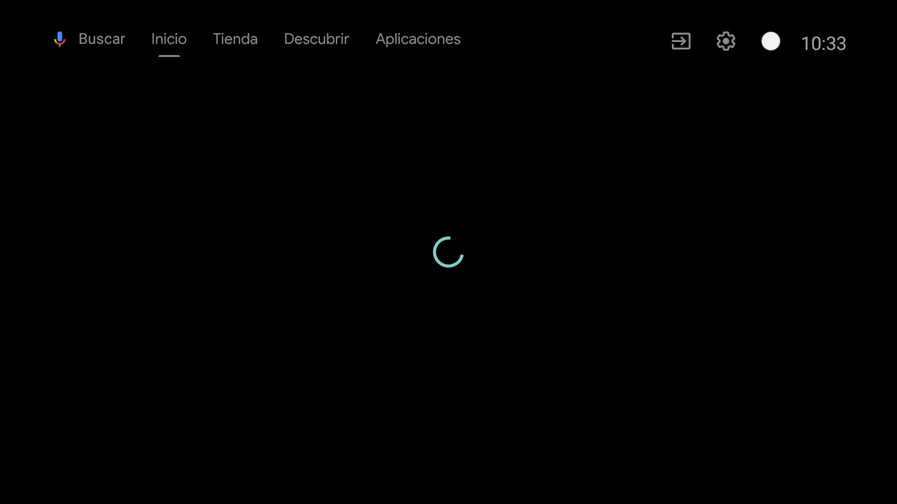
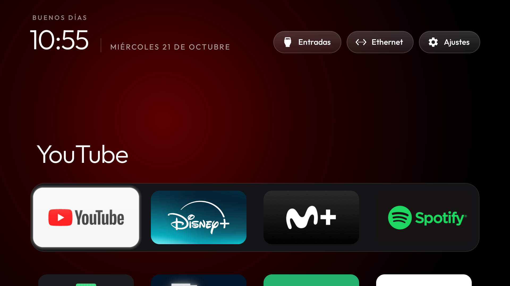
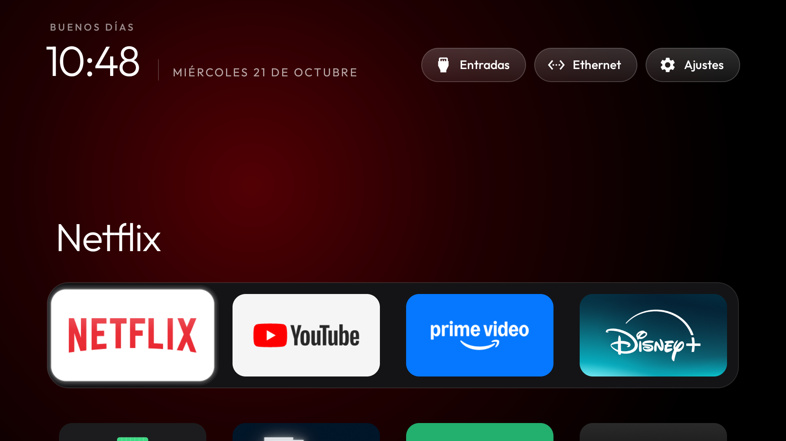
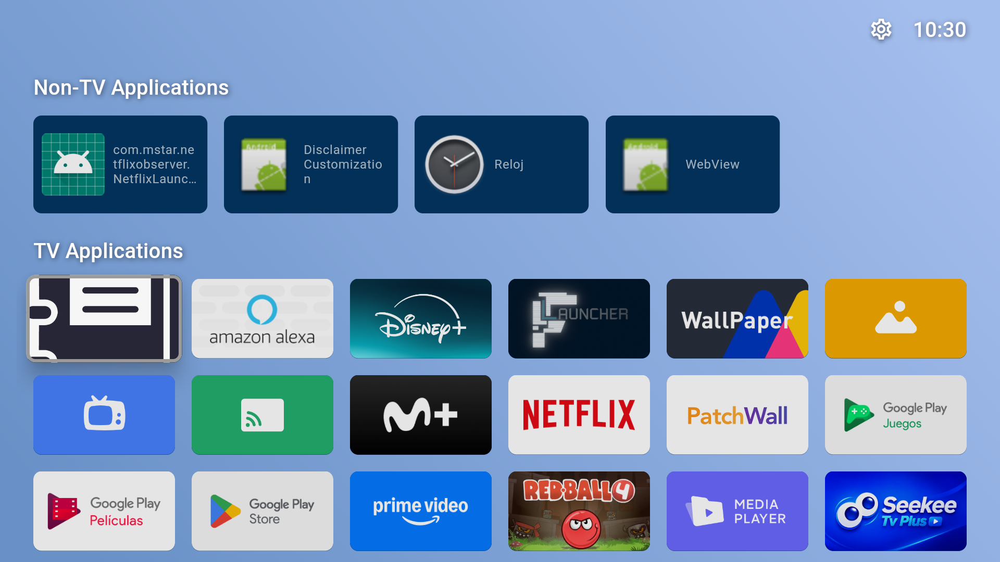

# CleanYourTV — Xiaomi Mi TV Edition (MiTV-MOOQ0)

> **Tu Android TV más rápida, sin anuncios y con una interfaz limpia inspirada en Apple TV.**  
> Basado originalmente en el proyecto de código abierto [CleanYourTV](https://github.com/Gathin23/cleanyourtv) de [Gathin23](https://github.com/Gathin23), adaptado y optimizado específicamente para modelos **Xiaomi Mi TV** (serie `MiTV-MOOQ0`, chip MediaTek / Android TV 10).

---

## 📸 Vista Previa (Capturas Reales)

| Pantalla de inicio limpia | Dock de aplicaciones personalizadas |
| :---: | :---: |
|  |  |

| Vista completa del launcher | Apps optimizadas tras debloat |
| :---: | :---: |
|  |  |

---

## ⚡ ¿En qué consiste?

Los televisores con Android TV / Google TV suelen saturarse con publicidad, recomendaciones patrocinadas y servicios en segundo plano del fabricante que ralentizan el sistema.

Este proyecto permite:
1. **Eliminar Bloatware y Telemetría:** Desactiva servicios innecesarios de Xiaomi y Google mediante `adb shell pm disable-user --user 0`. **No requiere root ni cables**, no borra particiones del sistema y se puede revertir al 100%.
2. **Launcher Ultra Ligero (~405 KB):** Reemplaza el launcher cargado de publicidad por una pantalla de inicio nativa en Java/AndroidX, minimalista y fluida, diseñada para televisores con recursos limitados (1 GB / 2 GB RAM).
3. **Dock y Accesos Personalizables:** Configura tus aplicaciones preferidas en el Dock (YouTube, Disney+, Movistar+, Spotify, etc.) y asigna accesos rápidos a los botones del control remoto.

---

## 📋 Requisitos

* **En la TV:**
  * Opciones de desarrollador activas (Pulsar 7 veces sobre *Ajustes > Preferencias del dispositivo > Información > Número de compilación*).
  * Activar **Depuración USB** y **Depuración de red**.
  * Conectar la TV y el ordenador a la misma red Wi-Fi o Ethernet.
* **En el Ordenador:**
  * **Android Platform-Tools (`adb`)** en el PATH.
  * **Java JDK 17+** (o Android Studio instalado).
  * **PowerShell** (Windows) o **Bash** (macOS / Linux).

---

## 🚀 Guía de Inicio Rápido (Replicación)

### 1. Conectar a la TV vía ADB
Localiza la IP de tu TV en los ajustes de red y conéctate:

```powershell
adb connect 192.168.1.XX:5555
```
*(Confirma la autorización que aparecerá en la pantalla del televisor).*

---

### 2. Aplicar Debloat (Limpieza de aplicaciones innecesarias)

Ejecuta el script de deshabilitación con la lista probada para **Xiaomi Mi TV**:

```powershell
# En Windows (PowerShell):
.\tools\disable.ps1 -TvHost 192.168.1.XX -Packages examples\xiaomi-mitv-mooq0\debloat.txt

# En Linux / macOS (Bash):
TV_HOST=192.168.1.XX ./tools/disable.sh examples/xiaomi-mitv-mooq0/debloat.txt
```

La lista optimizada desactiva:
* Analíticas y telemetría de Xiaomi (`com.miui.tv.analytics`, `com.xiaomi.statistic`).
* Canales recomendados y apps patrocinadas (`com.mitv.tvhome.michannel`, etc.).
* Servicio de actualización de firmware (`com.xiaomi.mitv.updateservice`) para evitar que una OTA deshaga la configuración.
* *(Mantiene intactas las apps de streaming y YouTube Kids)*.

---

### 3. Compilar e Instalar el Launcher

Compila el APK e instálalo como launcher predeterminado en un solo comando:

```powershell
# En Windows (PowerShell):
.\launcher\build-and-install.ps1 -TvHost 192.168.1.XX

# En Linux / macOS (Bash):
TV_HOST=192.168.1.XX ./launcher/build-and-install.sh
```

El script detecta el SDK de Android, compila el launcher en modo *release*, lo transfiere a la TV y lo establece como la pantalla de inicio principal (`HOME`).

---


---

## 📺 Compatibilidad Universal (147 TV models)

Aunque este repositorio incluye configuraciones y capturas listas para la Xiaomi Mi TV (MiTV-MOOQ0), **es totalmente compatible con cualquier Android TV o Google TV**.

El proyecto conserva las listas de debloat probadas para **147 TV models** de decenas de fabricantes (**TCL**, **Sony**, **Xiaomi**, **Philips**, **Hisense**, **Amazon Fire TV**, **Google Chromecast**, **NVIDIA Shield**, proyectores y más).

Para aplicar la optimización en cualquier otro modelo de televisor, basta con indicar la lista correspondiente ubicada en la carpeta [examples/](examples/):

```powershell
# En Windows (PowerShell):
.\tools\disable.ps1 -TvHost 192.168.1.XX -Packages examples\<carpeta-de-tu-modelo>\debloat.txt

# En Linux / macOS (Bash):
TV_HOST=192.168.1.XX ./tools/disable.sh examples/<carpeta-de-tu-modelo>/debloat.txt
```

<details>
<summary><strong>Ver lista completa de modelos compatibles (haz clic para desplegar)</strong></summary>

| TV | OS |
|---|---|
| AiPro2K (Expressluck, dongnae; Changhong AI PONT family) | Android TV 14 |
| AIWA AI PONT SA (Changhong, osaka, ISDB86AW) | Google TV 14 |
| Amazon Fire TV 50" 4K smart TV (AFTTIFF43, brandenburg) | Fire OS 7.7.1.7 / Android 9 |
| Amazon Fire TV Stick 4K Max, 1st gen 2021 (AFTKA, kara), Colombia | Fire OS 7.7.1.3 / Android 9 |
| Amazon Fire TV Stick 4K, 1st gen 2018 (AFTMM, mantis) | Fire OS 6.7.1.1 / Android 7.1 |
| Amazon Fire TV Stick 4K, 2nd gen 2023 (AFTKM, karat), Brazil | Fire OS 8.1.8.5 / Android 11 |
| Amazon Fire TV Stick Lite, 1st gen 2020 (AFTSS, sheldon) | Fire OS 7.7.1.7 / Android 9 |
| BenQ E55-735 (Changhong AI PONT, DVB96BQ) | Google TV 14 |
| BenQ E55-750 (Changhong AI PONT, DVB96BQ) | Google TV (Android 11) |
| BYINTEK Love U4 projector, 1080P (Skyworth RG_HS352, HiSilicon Hi3751V350, 1 GB), Brazil | Android 9 |
| BYINTEK T5 Max projector (built-in Google TV stick: SkyworthDigital YYT, Amlogic), Brazil | Google TV 14 |
| Cecotec VQU10065S 65" QLED (Vestel-built, shandao, MediaTek), Spain | Android TV 14 |
| Challenger 32T22 BT (cvt_mt5863_col, board TP.MT5510.PB781, MediaTek MT5659, 1 GB RAM), Colombia | Android 7.0 |
| CHiQ AI PONT (Changhong GTVU65, dangni, MediaTek mt5867) | Google TV 14 |
| CHiQ AI PONT (DVB93CQ) | Android TV 11 |
| Chromecast with Google TV 4K (sabrina) | Google TV 14 |
| Compac ATV R2 (SCBC R2, Realtek RTD285O) | Android TV 9 |
| EKO 2K Google TV (MTC-built, tennoji, MediaTek mt5867 / T56) | Google TV 14 |
| FFalcon (雷鸟) 鹤6 PRO 65S585C Pro (China, tcl_mt5879_cn, MediaTek MT9653) | Android TV 11 |
| Freebox Player POP (Free, fbx8am, Amlogic), IPTV/DVB-T box | Android TV 10 |
| Google TV Streamer 4K (kirkwood, GZRNL) | Google TV 14 |
| Haier Android TV DVB2K (broadway, HaierATVT56DVB) | Android TV 11 |
| Haier H32S80EFX (MatrixTV CE, HRT56EU, deto, MediaTek), Thailand | Google TV 14 |
| Hisense E5Q Pro (VIDAA_TV, MediaTek MT9653), China | Android TV 11 |
| Hisense HG9 (HiSmart 4K A4FFM) | Android TV 9 |
| Hisense HiSmartTV A4 (xiaoyushan, MStar m7322), Android 11 firmware RTT2.221108.001 | Android TV 11 |
| Hisense HiSmartTV A4 (xiaoyushan, MStar m7322), India | Android TV 9 |
| Hisense SmartTV 4K FFM (huangshan, MediaTek) | Android TV 10 |
| Hisense U75 (hengshan, MediaTek), Latin America | Google TV 12 |
| Hitachi 65QLEDSM20 (MTC, bangbae, MediaTek m7322), Australia | Android TV 11 |
| Hitachi CDH-LE32SMART21 (TCL-built C06, C06_2K_GB, MediaTek MT9221, 1 GB), Argentina | Android TV 11 |
| Insignia 55" F30 4K Fire TV (NS-55F301NA25, AFTDCT31, duckie) | Fire OS 7 / Android 9 |
| JMGO N1S projector (K80A, holan, MediaTek m7332), Australia | Google TV 14 |
| JVC Android TV (Vestel-built, BARTU_Jvc, menlo, MediaTek mt5867), Spain | Android TV 11 |
| Kalley 43G200 (device R3_GTV, MOKA, Realtek RTD2841A), Latin America | Google TV 14 |
| Kalley R10G (device R10G, product ACER_FFM, MOKA, Realtek RTD2875P), Latin America | Google TV 14 |
| Kogan Google TV (Changhong CHiQ AI PONT, GTVU65KG, dangni, MediaTek mt5867), Australia | Google TV 14 |
| Motorola SWTV-24AE-FHD (Skyworth OEM, beomil, MediaTek), India/Global | Google TV 14 |
| MTC UK 2K Android TV (tabata, MediaTek m5621; JVC-family firmware, `android.autoinstalls.config.JVC` present), UK | Android TV 11 |
| NVIDIA SHIELD TV 2019 tube (P3430, sif) | Android TV 11 |
| NVIDIA SHIELD TV Pro 2019 (P2897, mdarcy) | Android TV 11 |
| OnePlus TV (D00, Dubai) | Google TV 14 |
| OnePlus Y1 43" (Y Series, shibuya) | Android TV 11 |
| onn 4K Streaming Box (2023, Walmart; YOC, Amlogic), US | Google TV 14 |
| onn. 4K Plus Streaming (2025, Walmart; coffey, Amlogic S905X5M), US | Google TV 14 |
| Panasonic 4KTV-0SU (Skyworth-built SW4H, MediaTek m7332), Gulf region | Android TV 10 |
| Panasonic 4KTV-JUP (Jupiter_PA, MediaTek) | Android TV 11 |
| Panasonic TH-40HS550K (Skyworth-built, GS655 shibuya, MediaTek) | Android TV 11 |
| Philips 50PUS8517/12 (TP Vision, PH1M_EA_9970A, MediaTek MT5895), Europe | Android TV 11 |
| Philips 55OLED707/12 (TP Vision, PH1M_EA_9970A, MediaTek MT5895), UK | Android TV 11 |
| Philips 55PUS7503/12 (TP Vision TPM171E, PH7M_EU_5596, MediaTek MT5891), Europe | Android TV 8.0 |
| Philips 65PUS8102/12 (TP Vision TPM171E, PH7M_EU_5596, MediaTek MT5891), Europe | Android TV 8.0 |
| Philips 75PUS8505/12 (TP Vision TPM191E, PH9M_EA_5599, MediaTek MT5887), Europe | Android TV 12 |
| Philips R8G Google TV (MOKA, whitefield, Realtek RTD2851F), US | Google TV 14 |
| Philips Smart 4K TV (Skyworth, eleonas, MediaTek), India | Google TV 14 |
| Philips TPM191E (TP Vision, PH9M_EA_5599, MediaTek mt5887), Europe | Android TV 12 |
| Polytron 2K (WLTV POLYTRON2K, hayward; Hisense/CVTE board, MediaTek mt5867), Indonesia | Android TV 11 |
| Portronics Beem 470 Smart LED Projector (Allwinner H713, 1 GB), India | Android 11 |
| PRISM+ Q65 Ultra 2026 QLED 4K AI Google TV (R10G, PRISMPLUS_FFM, MOKA, Realtek RTD2875 SoC, RTD6748 platform) | Google TV 14 |
| RCA AI PONT SA (Changhong, redwood, ISDB92RC; also sold as realme 40-inch) | Android 14 |
| Redmi TV (MiTV-ANTL0, starwars) | Android 5.1.1 (not Android TV) |
| SANYO ATV R2 (SCBC, Realtek RTD285O) | Android TV 9 |
| SHARP AQUOS TVE21F (AQUOS-TVE21F, banqiao, CVTE/MediaTek), UK | Android TV 14 |
| Skyworth SWTV-21AE (sunnyvale, MediaTek) | Android TV 14 |
| Skyworth SWTV-24NA-4K NF (eleonas, MediaTek mt5896), US | Google TV 14 |
| Sony BRAVIA 4K AE2 (BRAVIA_AE2, MediaTek MT5897), North America | Google TV 14 |
| Sony BRAVIA 4K GB (BRAVIA_ATV2_EU, BRAVIA_ATV2) | Android TV 9 |
| Sony BRAVIA 4K GB (BRAVIA_ATV2_UC, MediaTek mt5891) | Android TV 9 |
| Sony BRAVIA 4K UR2 (BRAVIA_UR2_4K, MediaTek) | Android TV 10 |
| Sony BRAVIA 4K VH2 (KD-55X80J, BRAVIA_VH2, MediaTek), EU | Google TV 12 |
| Sony BRAVIA 4K VH21 (KD-65X85K, 2022, BRAVIA_VH21, MediaTek MT5895), Australia | Google TV 12 |
| Sony BRAVIA 9 II (K-65XR90M2, BRAVIA_AE3, MediaTek MT5838) | Google TV 14 |
| Sony BRAVIA BF1 (BRAVIA 2 II class, BRAVIA_BF1_4K_A, MediaTek) | Google TV 12 |
| Sony BRAVIA KD-49X8307C (2015, "BRAVIA 4K 2015", SVP-DTV15, MediaTek), EU firmware | Android TV 7.0 |
| Sony BRAVIA KD-55X8509C (2015, "BRAVIA 4K 2015", SVP-DTV15, MediaTek), EU firmware | Android TV 7.0 |
| Sony BRAVIA KD-55X85J (2021, BRAVIA_VH2, MediaTek MT5895), South America | Google TV 12 |
| Sony BRAVIA KD-55XE8596 (2017, "BRAVIA 4K GB", BRAVIA_ATV2_EU, MediaTek MT5891), UK | Android TV 9 |
| Sony BRAVIA KD-65X80J (2021, BRAVIA_VH2, MediaTek), India | Google TV 10 |
| Sony BRAVIA KD-65X9300D (2016, SVP-DTV15, MediaTek), Asia-Pacific | Android TV 8.0 |
| Sony BRAVIA TL2 (OD0M_EA_T32, TPV-built, MediaTek), Europe | Android TV 11 |
| Sony BRAVIA VU31 4K (BRAVIA_VU31_4K, Realtek), India | Google TV 14 |
| Sony BRAVIA XBR-65X900E (2017, BRAVIA_ATV2) | Android TV 9 |
| Sony BRAVIA XBR-65X900F (2018, BRAVIA_ATV3_4K, MediaTek MT5891), US/Canada | Android TV 9 |
| Stellamore T950S projector (Droidlogic be30a3, Amlogic txhd2) | Android 13 |
| TCL / FFalcon China (tcl9655_cn, MediaTek MT9655 "merak", UTT2.250416.001 AU01) | Android 14 |
| TCL 32L5A (C06, model "Smart TV", 1 GB) | Android TV 11 |
| TCL 32S5400A (C06, C06_2K_GB, MediaTek MT9221, 1 GB), 2023 | Android TV 11 |
| TCL 32S5K (C06, C06_2K_GB, MediaTek MT9221, 918 MB), EU | Android TV 11 |
| TCL 40S5400A (C06, C06_2K_GB, MediaTek MT9221, 1 GB) | Android TV 11 |
| TCL 43C645 (Smart TV Pro, Realtek RTD2851 / R51MT05, V8-R51MT05-LF1V652) | Google TV launcher on Android TV 11 |
| TCL 43EP660 (Europe, BeyondTV, Realtek rtd285o, V8-R851T02-LF1V378) | Android TV 9 |
| TCL 43S5K (G13, G13_2K_GB, MediaTek MT9221, 1 GB), India | Google TV 14 |
| TCL 50EP680 (Europe, BeyondTV, Realtek rtd285o) | Android TV 11 |
| TCL 55" 4K Google TV, 2023 (G10, G10_4K_US_NF); also TCL 55P6K, Spain (G10_4K_GB_NF_32BIT) | Google TV 12 |
| TCL 55C715 QLED (Europe, BeyondTV2, Realtek RTD2851, V8-R851T02-LF1V606) | Android TV 9 |
| TCL 55C725 (Smart TV Pro, BeyondTV4, G03_4K_GB, Realtek R51MT05, V8-R51MT05-LF1V620), Italy | Google TV launcher on Android TV 11 |
| TCL 55C815 (2020, Europe/Denmark, BeyondTV2, Realtek rtd285o) | Android TV 11 |
| TCL 55P7K, Middle East (G10, G10_4K_GB, Realtek RTD2875P) | Google TV 12 |
| TCL 55Q10G Pro (China, tcl_mt5879_cn, MediaTek MT9952) | Android TV 11 |
| TCL 55S470G (G10, G10_4K_US_NF, Realtek), US | Google TV 12 |
| TCL 65C725 (Smart TV Pro, BeyondTV4) | Android TV 11 |
| TCL 65C735 (Smart TV Pro, G05, MediaTek), France | Google TV 11 |
| TCL 85RM7L (G08, G08_4K_GB, MediaTek tcl9618) | Google TV 14 |
| TCL ak30a5 (China, Amlogic) | Android TV 9 |
| TCL BeyondTV (India) | Android TV 9 |
| TCL BeyondTV, EU/Nordic (Realtek RTD2851, V8-R851T02-LF1V606) | Android TV 9 |
| TCL BeyondTV2 (Latin America / Brazil, Realtek RTD2851) | Android TV 9 |
| TCL BeyondTV2, Android 11 build (AR05, Realtek rtd285o) | Android TV 11 |
| TCL C755 QD-Mini LED, 2024, Australia (G08, MediaTek tcl9618) | Google TV 14 |
| TCL L40S66E (C06, C06_2K_GB, MediaTek MT9221, 1 GB), Argentina | Android TV 11 |
| TCL QM6K Pro, 2025 (G08, MediaTek tcl9618) | Google TV 14 |
| TCL Smart TV (G07, G07_4K_GB_NF, Realtek RTD2851A, 2 GB) | Google TV 11 |
| TCL Smart TV Pro (G03, G03_4K_GB, BeyondTV4, Realtek R51MT05, V8-R51MT05-LF1V620), Middle East firmware | Google TV 11 |
| TCL Smart TV Pro (G05, G05_4K_US, MediaTek MT5889) | Google TV 11 |
| TCL Smart TV Pro (G09, G09_4K_GB, Amlogic T5M, 2 GB), UK firmware, Brazil | Google TV 12 |
| TCL UnionTV, Latin America (TCL-built like Thomson 32HE5800, Realtek RT2841) | Android TV 9 |
| Tele System TS ON T2/HD (ONT2HD, SDMC, Amlogic), Italy | Android TV 11 |
| Thomson 32HE5800 (TCL-built UnionTV, Realtek RT2841), Spain | Android TV 9 |
| Thomson T32RTL6000 (SCBC, Realtek; Android reports model `ATV R1`) | Android TV 9 |
| Toshiba (Vestel Cosmos170, yeoksam, MediaTek), Spain | Android TV 11 |
| Toshiba Fire TV (AFTHA004, hazel) | Fire OS 7 / Android 9 |
| Verizon Stream TV, 1st gen (WNC JS8V, Amlogic), US | Android 12 |
| Vidda VIDAA_TV (Hisense sub-brand; device MT9653, board mt5879), China JuUI | Android TV 11 |
| Vision 2024VISION43STV (CVTE TP.T950D4T.PB751, Amlogic T950D4, 1 GB), Europe | Android 13 |
| Vu 4K (HVCL, lushan, MediaTek), India | Google TV 12 |
| Vu Premium FHD 43-inch (Smart 2K ATV4, hamamatsucho), India | Android TV 9 |
| Wanbo X5 Pro projector (built-in Google TV stick: SkyworthDigital YYT, Amlogic), Australia | Google TV 14 |
| XGIMI Horizon S Pro projector (XK03H, xgimigalileo, MediaTek) | Android TV 11 |
| XGIMI MoGo 2 projector (MoGo, xgimiapollo, pokemon) | Android TV 11 |
| XGIMI MoGo 3 Pro projector (G0035, altai, MediaTek) | Google TV 14 |
| Xiaomi Mi Box S (MIBOX4, oneday), streaming box | Android TV 9 |
| Xiaomi Mi Box S 2nd gen (MiTV-AFKR0, jaws), streaming box | Google TV 11 |
| [Xiaomi Mi TV (MiTV-MOOQ0, croods)](docs/devices/xiaomi-mitv-mooq0.md) | Android TV 10 |
| Xiaomi Mi TV 4A (MiTV-MOOQ1) | Android TV 10 |
| Xiaomi MiTV-AESP0 stick (aquaman, 1 GB) | Android TV 9 |
| Xiaomi MiTV-ANSP0 (小米电视5 Pro 65", jobs, Amlogic), China firmware 23.6.5.3226, 4 GB RAM | Android TV 9 (CN build) |
| Xiaomi MiTV-ASTP1 (maverick), China firmware 2.40.641.0514.cn, 1 GB RAM, 720p | Android TV 9 (CN build) |
| Xiaomi MiTV-AXFR1 (rango, Amlogic, 1 GB), India | Android TV 11 |
| Xiaomi MiTV-AXSO0 (dangal; Mi TV 4C Pro 2019 / 4A Pro) | Android TV 9 |
| Xiaomi MiTV-AXSO2 (dangalUHD, India, 2 GB) | Android TV 9 |
| Xiaomi MiTV-MOOR2 (venom, MediaTek) | Google TV 11 |
| Xiaomi MiTV-MOSR4 (irobot, MediaTek) | Google TV 11 |
| Xiaomi MiTV-MSSP3 (machuca, MediaTek) | Android TV 11 |
| Xiaomi MiTV-MSSP3 (machuca, MediaTek), Android 9 firmware PI.7524 | Android TV 9 |
| Xiaomi TV A Pro 75" 2026 (MiTV-MZTU0, river, MediaTek) | Google TV 14 |
| Xiaomi TV Box S 3rd gen (MiTV-AFMU0, twilight, Amlogic), streaming box | Google TV 14 |
| Xiaomi TV S Pro 100 Mini LED 2025 (小米电视 S Pro 100, L100MB-SP, MiTV-MFFU0, finch, MediaTek), China firmware OS3.0.115.0.UFFMATV, 4 GB RAM | Android 14 (HyperOS 3, CN build) |

</details>

## ⚙️ Personalización del Launcher

Puedes personalizar las aplicaciones del dock y las teclas del control remoto antes de compilar editando [`launcher/app/src/main/res/values/config.xml`](launcher/app/src/main/res/values/config.xml):

```xml
<!-- Apps ancladas en la fila del dock inferior -->
<string-array name="dock_apps">
    <item>com.google.android.youtube.tv</item>
    <item>com.disney.disneyplus</item>
    <item>com.movistarplus.androidtv</item>
    <item>com.spotify.tv.android</item>
</string-array>

<!-- Keycodes especiales del control remoto (ej. tecla 130) -->
<integer-array name="input_key_keycodes">
    <item>130</item>
</integer-array>
```

---

## 🔄 Restauración (Deshacer Cambios)

Si deseas restaurar el televisor a su estado original (rehabilitar todas las aplicaciones del fabricante y volver al launcher stock de Google/Xiaomi):

```powershell
.\examples\xiaomi-mitv-mooq0\restore.ps1 -TvHost 192.168.1.XX
```

El script rehabilita todos los paquetes desactivados y reactiva el launcher original (`com.google.android.tvlauncher`).

---

## 📖 Documentación Detallada

* [Guía técnica específica de Xiaomi Mi TV (MiTV-MOOQ0)](docs/devices/xiaomi-mitv-mooq0.md)
* [Solución de problemas (Troubleshooting)](docs/TROUBLESHOOTING.md)
* [Mapeo de botones del mando a distancia](docs/REMOTE.md)

---

## 🤝 Créditos y Atribución

Este proyecto utiliza como base el software de código abierto [CleanYourTV](https://github.com/Gathin23/cleanyourtv), creado por [Gathin23](https://github.com/Gathin23). 

Agradecimientos al autor original y a la comunidad por el desarrollo del launcher base y la infraestructura de scripts ADB.

## 📄 Licencia

Este repositorio se distribuye bajo la licencia **MIT** (ver [`LICENSE`](LICENSE)).  
La fuente tipográfica *Outfit* está protegida por la licencia SIL Open Font License (ver `launcher/FONT-LICENSE-OFL.txt`).
